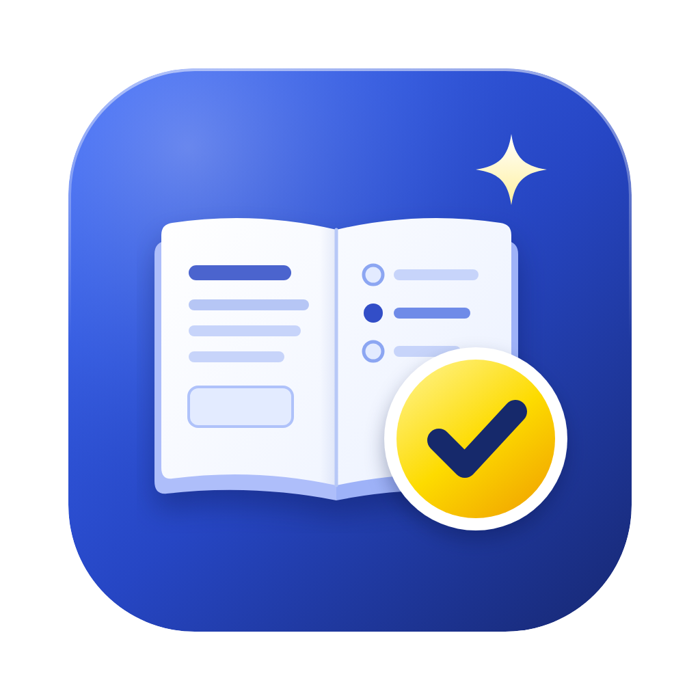
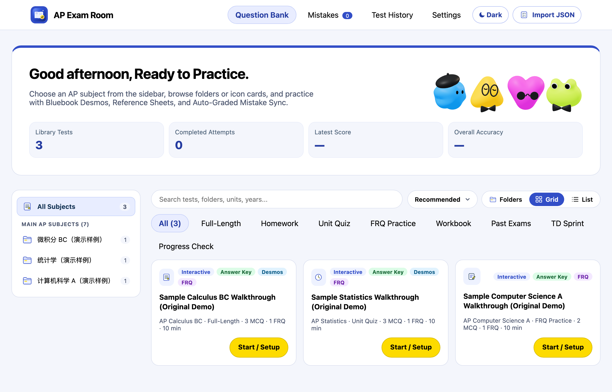
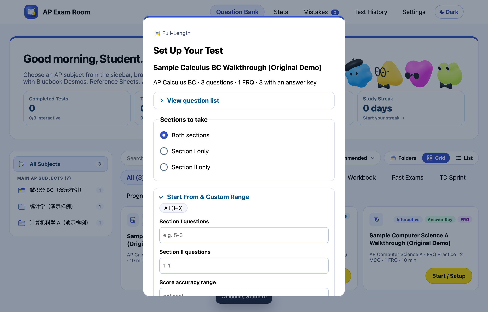
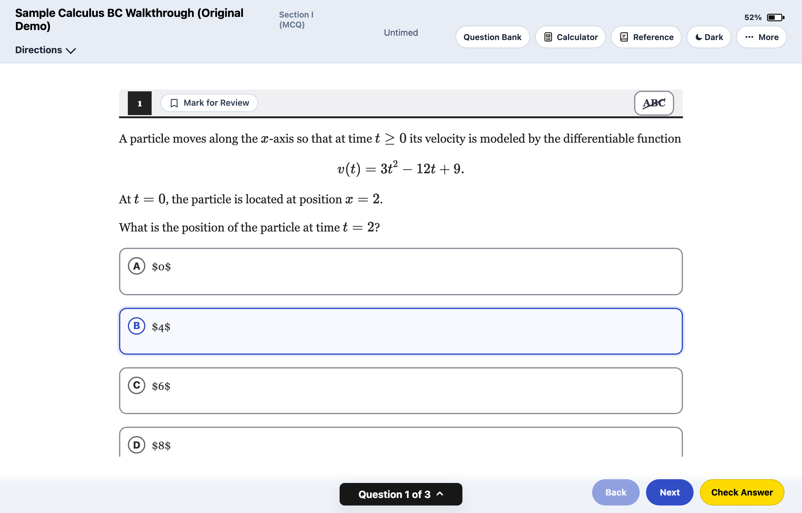
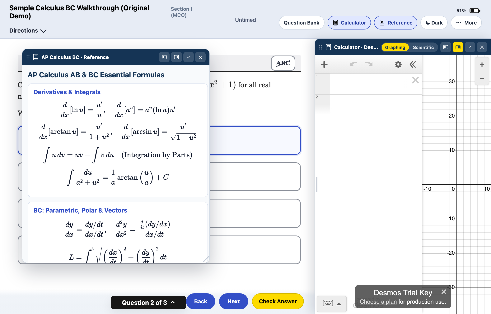
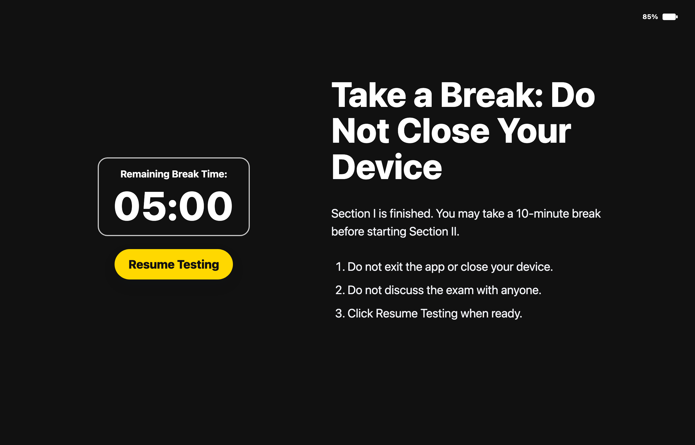
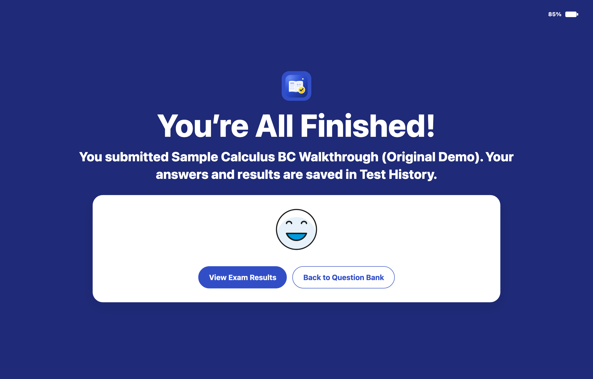
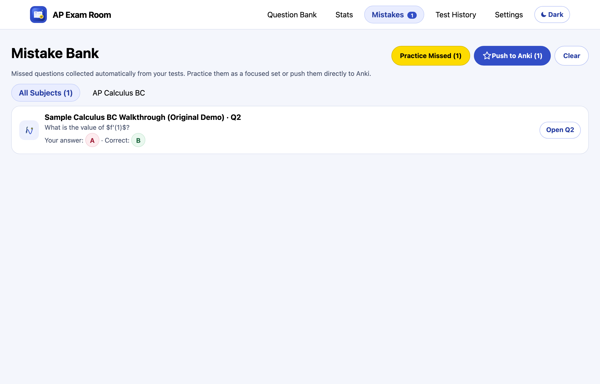

<p align="center">
  
</p>

<h1 align="center">AP Exam Room (AP 模考室)</h1>

<p align="center">
  <strong>English</strong> | <a href="README.zh-CN.md">简体中文</a>
</p>

<p align="center">
  <strong>Local-first, Bluebook-inspired AP practice & mock exam suite for macOS, Windows (zero-dependency), and Portable Web / iPad LAN.</strong><br>
  <em>Software only — no copyrighted AP question banks or PDFs are distributed. Includes 3 tiny original demo walkthroughs to showcase every screen.</em>
</p>

---

## Disclaimer & Legal Notice

1. **No Affiliation / No Official Endorsement**  
   **AP Exam Room** is an independent, open-source educational practice runner. It is **NOT affiliated with, endorsed by, sponsored by, or officially connected with College Board**, **Desmos Studio PBC**, **Khan Academy**, or **Mozilla** in any way.
2. **Trademarks**  
   **AP®**, **Advanced Placement®**, **College Board®**, and **Bluebook™** are registered trademarks of College Board. **Desmos®** is a registered trademark of Desmos Studio PBC. All trademarks belong to their respective owners and are referenced strictly for identification of UI inspirations and compatible tools.
3. **Software Only — No Question Banks Included**  
   This repository and all Release archives contain **software source code/executables plus only 3 minimal 100% original sample walkthrough sets** (`Source/Data/exams/demo_calc_bc.json`, `demo_stats.json`, `demo_csa.json`). No proprietary College Board exams, third-party commercial prep banks, answer keys, PDFs, or videos are included.  
   Users are **solely responsible** for ensuring they hold lawful rights/permissions for any external JSON question banks or local PDF files they import into the app.
4. **"AS IS" Warranty & No Liability**  
   This software is provided **"AS IS"**, without warranty of any kind, express or implied (see [LICENSE](LICENSE)). Practice timers, interface behaviors, and automated grading accuracy **do not guarantee parity with official College Board Bluebook™ exam scoring or administration**. The authors assume no responsibility for exam outcomes or local browser/app data loss — please export backups regularly via **Settings → Download Backup**.

---

## College Board / Bluebook® Style Icons & Third-Party Assets

All non-original visual assets and bundled libraries are itemized with ownership and license scope in [`THIRD_PARTY_NOTICES.md`](THIRD_PARTY_NOTICES.md) and excluded from the repository's MIT License:

| Asset / Path | Attribution / Origin | UI Status | License Scope |
| --- | --- | --- | --- |
| `Source/Assets/face-excellent.svg` | College Board / Bluebook™-style smiling completion graphic | **Active** (Completion screen) | Proprietary CB-style asset (**not MIT**); replace for commercial redistribution |
| `Source/Assets/Bluebook_Logo_Mark.svg` | College Board Bluebook™ mark | **Unused** legacy reference | Proprietary CB mark (**not MIT**); active app uses original `RoomMark.svg` |
| `Source/Assets/book-open.svg`, `checklist-doc.svg`, `clock.svg`, `download.svg`, `graph-bar.svg`, `laptop-check.svg`, `lock.svg`, `practice.svg` | Bluebook™-style 48×48 UI icon files | **Unused** legacy reference | Proprietary CB-style SVGs (**not MIT**), retained with attribution |
| `Source/AppIcon.svg`, `Source/Icon/*`, `Source/Assets/RoomMark.svg`, `Source/Assets/icons/*.svg` | Original **AP Exam Room** app emblem & geometric subject/toolbar icons | **Active** | Original project artwork (MIT-compatible) |
| `Source/Assets/desmos.js` | Desmos® Calculator API (Trial Key) | **Active** (with offline canvas fallback) | Proprietary Desmos Studio PBC terms (**not MIT**) |
| `Source/Assets/pdfjs/` | Mozilla PDF.js | **Active** (Windows / Portable PDF mode) | Apache License 2.0 |
| `Source/Assets/katex.*`, `Source/Assets/fonts/` | KaTeX Math Typesetting | **Active** | MIT License |
| Perseus embedded renderer (`Source/template.html`) | Khan Academy Perseus | **Active** | MIT License |
| `Source/Pets/` & `Source/Assets/RoomPets.js` | Three.js (MIT) + 3D study companion models/portraits | **Active** (toggleable in Settings) | Three.js MIT; `.glb`/`.png` models separate non-MIT assets |

---

## Download Latest Release (`v1.0.0`)

Prebuilt packages for **macOS**, **Windows**, and **Portable Web** are available on the [GitHub Releases](https://github.com/RanchoNICEGUY/ap-exam-room/releases/latest) page:

| Platform | Package | Requirements | Notes |
| --- | --- | --- | --- |
| **Windows 10 / 11** | `AP-Exam-Room-Windows-ZeroDep-v1.0.0.zip` | Built-in PowerShell + Microsoft Edge / Chrome | **Zero dependencies** (no Python/Node/admin required); unzip and double-click `Start-APExamRoom.bat` |
| **macOS** (Apple Silicon / Universal) | `AP-Exam-Room-macOS-v1.0.0.zip` | macOS 13+ | Native Swift + `WKWebView` + PDFKit app (`AP 模考室.app`); see Gatekeeper note below |
| **Cross-Platform / iPad LAN** | `AP-Exam-Room-Portable-Web-v1.0.0.zip` | Python 3 + modern browser | Run `python3 dev_server.py --lan` to open on Mac, Linux, Windows, or iPad Safari (PWA) |

### Platform Quick Start

#### Windows (Zero-Dependency Standalone)
1. Download and extract `AP-Exam-Room-Windows-ZeroDep-v1.0.0.zip` anywhere (for example `D:\AP-Exam-Room\`).
2. Double-click **`Start-APExamRoom.bat`** — PowerShell starts a lightweight local server (`127.0.0.1`) and opens AP Exam Room in an isolated Edge/Chrome app window.
3. *(Optional)* Double-click `设置题库PDF路径.bat` to point the viewer to a local folder of your own study PDFs.
4. *(Optional)* Install any free JDK (`javac.exe`, e.g., Eclipse Temurin JDK 17/21) to run AP CSA Java code locally via **Run Java**.

#### macOS (Native Desktop App)
1. Download `AP-Exam-Room-macOS-v1.0.0.zip`, unzip `AP 模考室.app`, and move it to `/Applications`.
2. Because this open-source build is ad-hoc signed rather than Apple-notarized, macOS Gatekeeper may flag downloaded zips on first launch. Clear the quarantine attribute once before opening:
   ```bash
   xattr -cr "/Applications/AP 模考室.app"
   open "/Applications/AP 模考室.app"
   ```
   Alternatively, build locally from `Source/` (requires Xcode Command Line Tools + Python 3):
   ```bash
   cd Source && bash build-app.sh
   ```

#### iPad / Local Web Server
```bash
python3 dev_server.py --lan   # Serves http://<your-mac-ip>:18990/index.html
```
Open that LAN URL in Safari on iPad and tap **Share → Add to Home Screen** for a full-screen offline-friendly web app.

---

## Key Features

- **Bluebook-Style Exam Runner**: Split-pane and single-flow question layouts, KaTeX formulas, `ABC` option strikeout/elimination, `Mark for Review`, highlights & scratchpad notes, Question Navigator modal, and Light / Dark themes.
- **Smooth Drag & Side-Dock Popups**: Pointer-event dragging across **Desmos Calculator** (with offline canvas graphing/scientific fallback) and **Reference Sheet**; drag to left/right viewport edges for animated snap preview & workspace reflow, adjust width with corner/edge splitters, and auto-close every popup cleanly when entering *Check Your Work*.
- **Instant Practice Mode + Confetti**: Full-width bottom feedback dock keeping **Continue** aligned directly over **Check Answer**, animated explanation drawer, audio feedback cues, and 2× Retina confetti.
- **Interactive Java FRQ Editor (AP CSA)**: Built-in Java code editor with local `javac` / `java` compilation & stdout/stderr panel.
- **Dual-Pane PDF Engine**: Native PDFKit rendering on macOS (`pdf_helper.swift`) and bundled offline Mozilla PDF.js on Windows / Web, paired with an interactive MCQ bubble sheet & FRQ rubric checklist.
- **Mistake Bank, History & Anki Export**: Persistent history (`History.swift` SQLite / browser storage), targeted missed-question re-practice, JSON export/import, and one-click AnkiConnect push.

---

## Interface Screenshots

All 16 screenshots below were captured in headless Chromium at 2× Retina scale using strictly the **3 original demo sets**:

### 1. Question Bank & Setup

| Question Bank (Light) | Question Bank (Dark) | Test Setup Dialog |
| :---: | :---: | :---: |
|  |  |  |

### 2. Exam Workspace, Practice Feedback & Side-Docking Popups

| Section I MCQ Workspace | Instant Practice Feedback + Confetti | Desmos Docked Right + Floating Reference |
| :---: | :---: | :---: |
|  |  |  |

| Desmos Docked Left (Dark Mode) | Question Navigator Grid | Check Your Work (Popups Auto-Closed) |
| :---: | :---: | :---: |
|  |  |  |

### 3. Inter-Section Break, AP CSA Java Editor & Completion

| Break Timer Screen | AP CSA Java FRQ Editor | Completion Screen (`face-excellent.svg` noted as CB-style) |
| :---: | :---: | :---: |
|  |  |  |

### 4. Results, Mistake Bank, History & Settings

| Test Results Overview | Mistake Bank | Test History | Settings |
| :---: | :---: | :---: | :---: |
|  |  |  |  |

---

## Bring Your Own Question Bank (JSON Import)

Import custom tests (up to 4 MB per UTF-8 `.json` file) via **Question Bank → Import JSON**.  
Full schema documentation and examples: [`docs/JSON_IMPORT_FORMAT.md`](docs/JSON_IMPORT_FORMAT.md).
