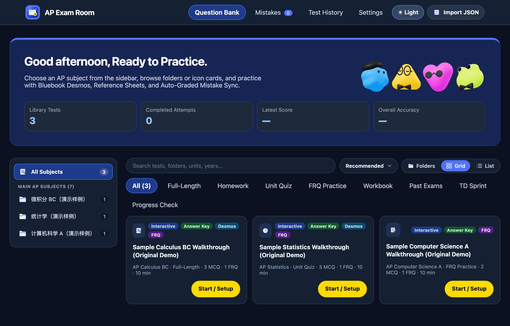
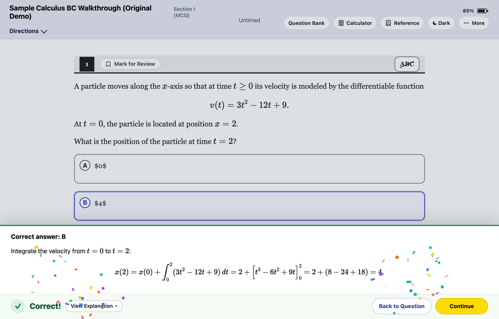
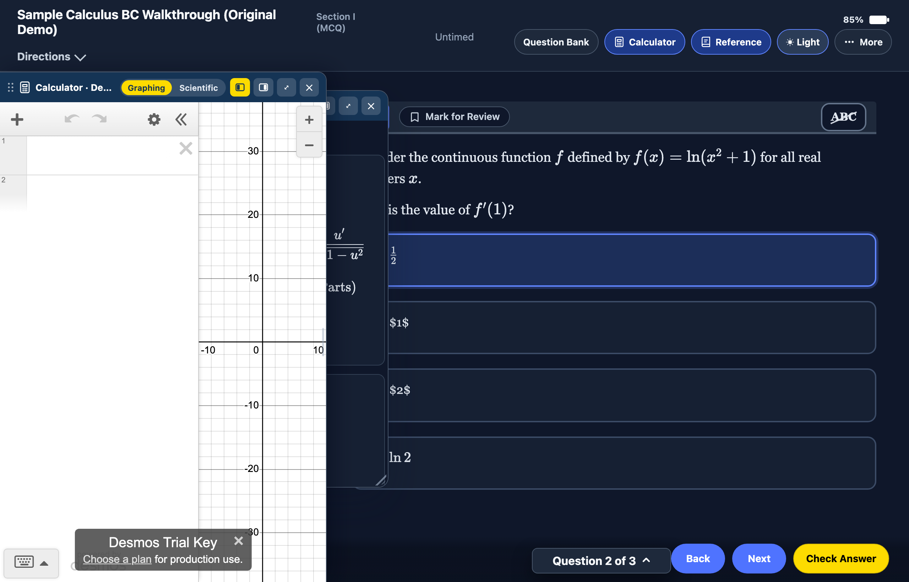
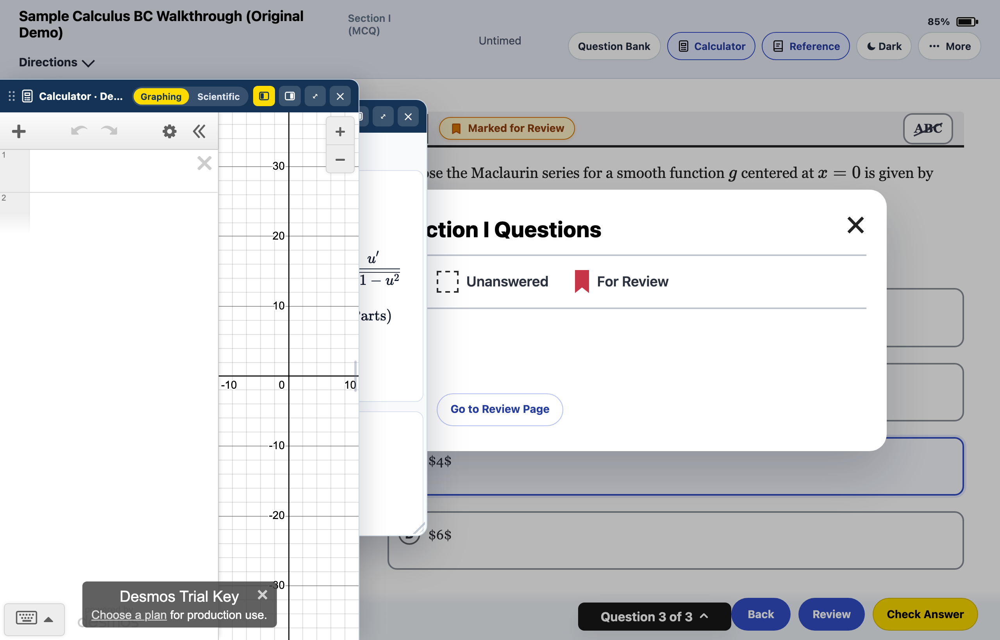
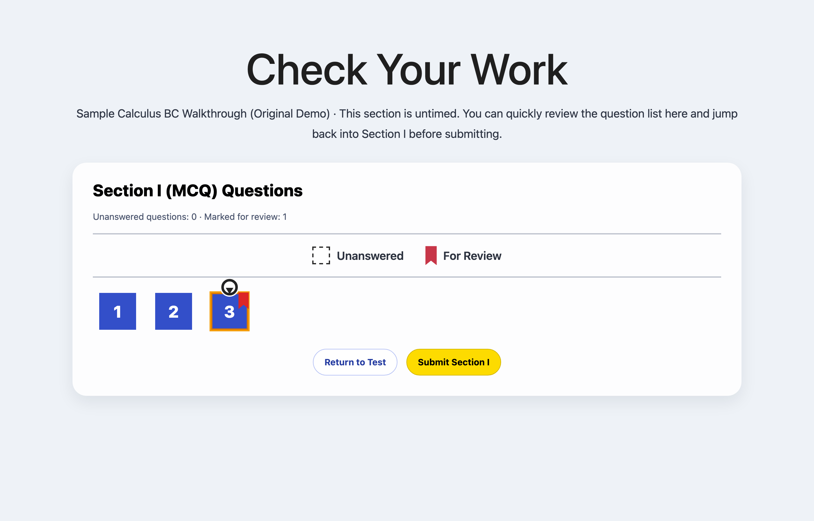
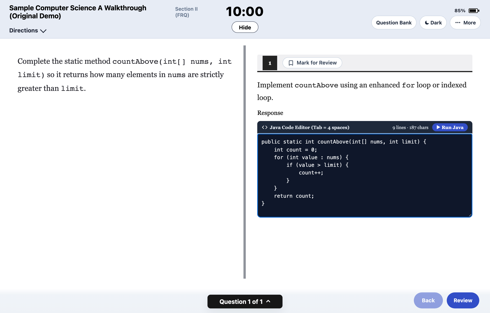
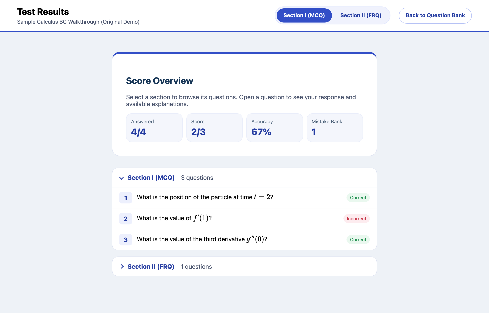
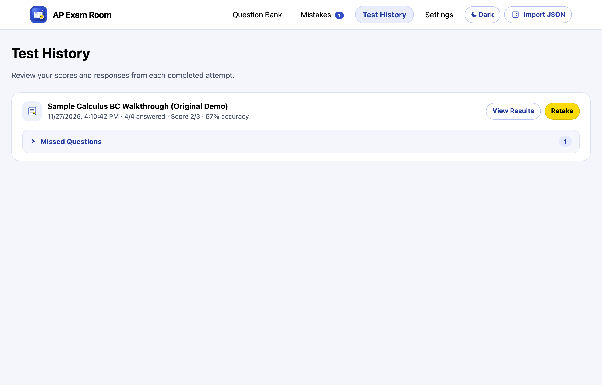
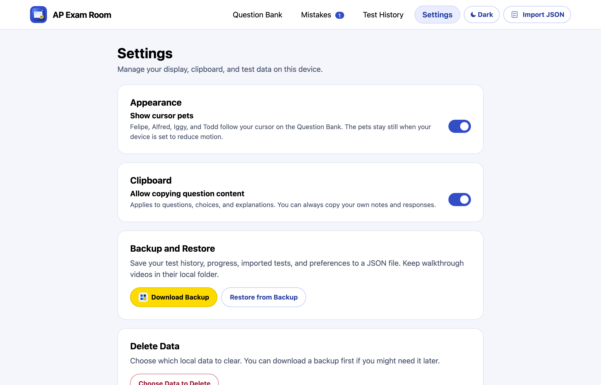

<p align="center">
  
</p>

<h1 align="center">AP 模考室 · AP Exam Room</h1>

<p align="center">
  <strong>Local-first, Bluebook-inspired AP Exam Runner for macOS (Swift + WKWebView), Portable Web (Mac / iPad LAN), and Zero-Dependency Windows.</strong><br>
  <em>纯软件仓库，不含任何真实题库或真题 PDF；附带 3 套 100% 原创演示样例（Demo），支持导入自有 JSON 题库与本地 PDF。</em>
</p>

---

## Important Notices · 重要说明（题库与 CB / 第三方素材标注）

1. **No Proprietary Question Banks Included · 不含真实题库与真题**  
   This repository contains **only the application source code** plus **3 tiny original self-authored demo sets** (`Source/Data/exams/demo_calc_bc.json`, `demo_stats.json`, `demo_csa.json`). All proprietary question banks, answer keys, PDFs, and walkthrough videos have been excluded. Bring your own question sets via **Question Bank → Import JSON** ([Format Spec](docs/JSON_IMPORT_FORMAT.md)).
2. **College Board / Bluebook® Asset Notice · CB 与第三方图标标注**  
   This project is an independent study tool and is **not affiliated with or endorsed by College Board**.  
   - **Original Project Brand**: `Source/AppIcon.svg`, `Source/Assets/RoomMark.svg`, and `Source/Assets/icons/*.svg` are original icons created for AP Exam Room.  
   - **CB / Bluebook®-Style Assets (Non-MIT, trademarked to College Board)**:  
     - `Source/Assets/Bluebook_Logo_Mark.svg` — Bluebook™ mark (**unused in active UI**, kept only as legacy reference).  
     - `Source/Assets/face-excellent.svg` — Bluebook™-style completion mascot SVG (used on the Completion screen).  
     - `Source/Assets/book-open.svg`, `checklist-doc.svg`, `clock.svg`, `download.svg`, `graph-bar.svg`, `laptop-check.svg`, `lock.svg`, `practice.svg` — CB/Bluebook™-style 48×48 duotone SVGs (**unused in active UI**, preserved in `Source/Assets/`).  
   - **Other Non-MIT / Attribution Assets**: `Source/Assets/desmos.js` (Desmos® Calculator trial bundle), `Source/Assets/pdfjs/` (Mozilla PDF.js, Apache-2.0), `Source/Assets/katex.*` (KaTeX, MIT), Perseus renderer in `Source/template.html` (MIT), and `Source/Pets/` (Three.js MIT + 3D companion `.glb`/`.png` models).  
   Full file-by-file details and licenses are documented in [`THIRD_PARTY_NOTICES.md`](THIRD_PARTY_NOTICES.md).

---

## Key Features · 核心特性

- **Bluebook-Style Exam Workspace**: Split/single-pane native question layout, KaTeX math typesetting, option elimination (`ABC` strikeout), `Mark for Review` bookmarking, highlights & notes drawer, Question Navigator grid, and Light / Dark theme switching.
- **Draggable & Animated Side-Dockable Popups**: Floating Desmos Graphing/Scientific Calculator (with offline Canvas fallback) and Formula Reference Sheet powered by Pointer Events — drag anywhere smoothly, snap to left/right viewport edges with live translucent preview & workspace reflow, resize corners or dock splitters, and auto-close cleanly upon entering *Check Your Work*.
- **Practice Instant Feedback + Confetti**: Practice-mode `Check Answer` bar pins `Continue` at `0px` over the check button with smooth CSS-Grid explanation drawer, audio cues, and Retina canvas confetti.
- **AP CSA Interactive Java FRQ Editor**: Code editor supporting local `javac`/`java` compilation and execution inside the macOS desktop app.
- **Dual-Pane PDF Engine**: Built-in PDFKit native renderer (`pdf_helper.swift` on macOS) and offline Mozilla PDF.js fallback for portable web / Windows with interactive bubble sheet + FRQ rubric self-scoring.
- **Mistake Bank, Test History & Anki Export**: SQLite-backed persistence (`History.swift` / `dev_server.py`), per-question mistake bookmarking, one-click AnkiConnect push, and JSON backup/restore.

---

## Interface Screenshots · 全界面截图展示

All screenshots below were captured in headless Chromium at 2× Retina resolution using only the **3 original demo sets** (`demo_calc_bc`, `demo_stats`, `demo_csa`).

### 1. Question Bank & Setup · 题库主页与开考设置

| Question Bank (Light) | Question Bank (Dark) | Test Setup Dialog |
| :---: | :---: | :---: |
|  |  |  |

### 2. Exam Workspace, Instant Feedback & Floating / Side-Docked Tools · 作答界面、即时批改与侧边停靠弹窗

| Section I MCQ Workspace | Practice Feedback + Confetti + Drawer | Desmos Side-Docked Right + Floating Ref |
| :---: | :---: | :---: |
|  |  |  |

| Desmos Side-Docked Left (Dark) | Question Navigator | Check Your Work (Popups Auto-Closed) |
| :---: | :---: | :---: |
|  |  |  |

### 3. Break, AP CSA FRQ Code Editor & Completion · 休息倒计时、Java FRQ 编辑器与完卷页

| Inter-Section Break | AP CSA Java FRQ Editor | Completion Screen (uses CB-style `face-excellent.svg`) |
| :---: | :---: | :---: |
|  |  |  |

### 4. Results, Mistake Bank, Test History & Settings · 成绩复盘、错题本、历史记录与设置

| Test Results Overview | Mistake Bank | Test History | Settings |
| :---: | :---: | :---: | :---: |
|  |  |  |  |

---

## Quick Start · 快速开始

### macOS Native Desktop App (`.app`)
Requires Xcode Command Line Tools (`swiftc`) and Python 3:
```bash
cd Source
bash build-app.sh
open "AP 模考室.app"
```
This builds `AP 模考室.app`, `AP-Exam-Room-Portable/`, and `AP-Exam-Room-Windows-ZeroDep.zip`.

### Local Web Server (Mac / Linux / iPad LAN)
After running `Source/build-app.sh`, start the local Python server from `AP-Exam-Room-Portable/`:
```bash
python3 dev_server.py        # http://127.0.0.1:18990/index.html
python3 dev_server.py --lan  # Expose on LAN so an iPad on the same Wi-Fi can add to Home Screen as a PWA
```

### Windows (Zero-Dependency Portable)
Run `Source/build-app.sh` (or open `AP-Exam-Room-Portable/` on Windows) and double-click `Start-APExamRoom.bat`. Optional local JDK (`javac.exe`) enables Java FRQ compilation; see [`Source/win/Windows使用说明.txt`](Source/win/Windows使用说明.txt).

---

## Bring Your Own Question Bank · 导入自定义题库

See [`docs/JSON_IMPORT_FORMAT.md`](docs/JSON_IMPORT_FORMAT.md) for the JSON schema (`schemaVersion: 1`). Import UTF-8 `.json` files directly via **Question Bank → Import JSON**, or export missed questions to re-practice later.
